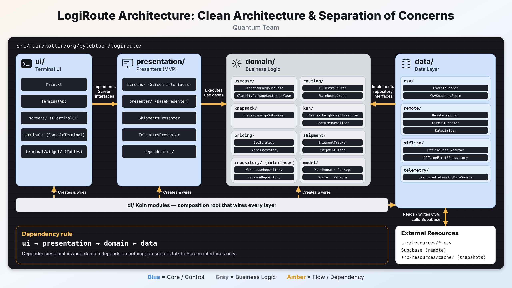

<div >


# LogiRoute

**A logistics and fleet-management platform built with Kotlin and Clean Architecture.**

Developed by **Quantum Team**


</div>

---

## Overview

LogiRoute manages the operational side of a logistics network: warehouses, routes, vehicles and packages, plus the decisions built on top of them — finding the cheapest path, loading a vehicle with the most valuable cargo, classifying a package into a delivery sector, dispatching shipments and following a fleet in real time.

The application runs as an interactive **terminal application**. Its presenters are written against screen interfaces, so the same business logic can be driven by another front end (the repository already contains a Compose Multiplatform module for that purpose).

## Features

| Area                       | What it does                                                                                                                          |
|----------------------------|---------------------------------------------------------------------------------------------------------------------------------------|
| **Data management**        | Create, read, update and delete warehouses, routes, vehicles and packages, with validation at the boundary.                           |
| **Shortest route**         | Dijkstra over the warehouse graph, with route legs, total distance and delay.                                                         |
| **Route analysis**         | Fewest-hops routing (uni- and bidirectional BFS), all-pairs shortest paths and hub-link verification.                                 |
| **Cargo optimisation**     | 0/1 Knapsack (weight, and weight + volume) to choose the best load for a vehicle.                                                     |
| **Classification**         | K-Nearest-Neighbors with min–max feature normalisation to assign a package to a delivery sector.                                      |
| **Pricing**                | Strategy pattern for shipping modes (eco, express, fragile) with Decorator add-ons (cold chain, express insurance, fragile handling). |
| **Dispatch and shipments** | Dispatch processors, a shipment state machine (created → assigned → in transit → delivered / failed) and delivery estimates.          |
| **Fleet planning**         | Consistent-hashing ring for assigning vehicles and coverage analysis.                                                                 |
| **Telemetry**              | Live simulated vehicle telemetry as a `Flow`, delay alerts and debounced search.                                                      |
| **Analytics**              | System overview and warehouse reports, including the hub hierarchy tree.                                                              |

## Architecture



LogiRoute follows **Clean Architecture**. Source-code dependencies point inwards: every outer layer knows the layers below it, and the domain knows nothing about anyone.

```text
        ┌───────────────────────────────────────────────┐
        │  ui            Terminal screens (implements   │
        │                the presentation interfaces)   │
        ├───────────────────────────────────────────────┤
        │  presentation  Presenters + Screen interfaces │
        ├───────────────────────────────────────────────┤
        │  domain        Models, use cases, algorithms, │
        │                repository contracts           │
        ├───────────────────────────────────────────────┤
        │  data          CSV, Supabase, offline-first   │
        │                repositories, telemetry        │
        └───────────────────────────────────────────────┘
        di  (Koin)  composition root that wires the layers together
```

### Layer responsibilities

| Layer            | Responsibility                                                                                                                                                      | Must not depend on                        |
|------------------|---------------------------------------------------------------------------------------------------------------------------------------------------------------------|-------------------------------------------|
| **domain**       | Business rules: entities, validators, use cases, routing / knapsack / KNN / pricing algorithms, shipment state machine, repository **interfaces**.                  | data, presentation, ui, di, any framework |
| **data**         | Implements the repository interfaces. CSV and Supabase access, DTOs and mappers, caching, offline-first reading, resilience (retry, circuit breaker, rate limiter). | presentation, ui                          |
| **presentation** | MVP presenters that orchestrate use cases and talk to a `Screen` **interface**. Contains no rendering code and no console or Android API.                           | ui, data, di, Koin                        |
| **ui**           | Terminal implementation of the `Screen` interfaces: menus, tables, widgets. Displays only; it never calls a use case or repository.                                 | use cases, repositories                   |
| **di**           | Koin modules that create and connect everything.                                                                                                                    | —                                         |

### Key design decisions

- **MVP with screen interfaces.** A presenter depends on `XScreen`; the terminal provides `XTerminalUI`. Replacing the UI means writing a new implementation, not touching business logic.
- **Offline-first data.** Reads try Supabase with a 3-second timeout and fall back to the local CSV cache; every successful remote read refreshes the cache.
- **Resilient remote calls.** Every remote call passes through one policy: retry with exponential backoff → circuit breaker → token-bucket rate limiter → error translation into typed domain exceptions.
- **Structured concurrency.** Independent work runs in `coroutineScope` with `async`; presenters launch work in a scope that is canceled when the application closes; `CancellationException` is never swallowed.
- **Typed errors.** Failures are domain exceptions, translated to user messages at the presentation boundary. No decisions are made by comparing message strings.
- **Architecture as tests.** Konsist tests in `src/test/.../architecture` check layer dependencies and naming rules on every build.

### Project structure

```text
src/main/kotlin/org/bytebloom/logiroute/
├── domain/
│   ├── model/            # Entities, inputs, results, validation, exceptions
│   ├── repository/       # Repository contracts
│   ├── usecase/          # One class per application action, grouped by feature
│   ├── routing/          # Dijkstra, BFS and shared graph code
│   ├── knapsack/         # Cargo-loading optimiser
│   ├── knn/              # Classifier, distance metric, normaliser, vote selector
│   ├── pricing/          # Strategies, decorators, factory
│   ├── shipment/         # Shipment state machine and tracker
│   ├── dispatch/         # Dispatch processors and outcomes
│   ├── tree/             # AVL tree and hub hierarchy
│   └── validator/        # Field and entity validators
├── data/
│   ├── csv/              # Data sources, parsers, snapshot cache, repositories
│   ├── remote/           # Supabase client, DTOs, mappers, resilience
│   ├── offline/          # Offline-first repositories and read executor
│   ├── telemetry/        # Simulated telemetry source
│   ├── geohash/          # Geohash encoder and warehouse spatial index
│   └── training/         # Training records built from package history
├── presentation/
│   ├── presenter/        # One presenter per screen
│   ├── screens/          # Screen interfaces (the contract with the UI)
│   └── dependencies/     # Use-case bundles for presenters with many dependencies
├── ui/
│   ├── screens/          # Terminal implementations of the screens
│   └── terminal/         # Terminal, menus, widgets and styling
└── di/                   # Koin modules

src/resources/            # Seed CSV files and project images
src/test/                 # Unit tests and architecture tests
frontend/logiroute/       # Compose Multiplatform front end (work in progress)
config/detekt/            # Static-analysis rules
```

## Getting started

### Requirements

- JDK 21
- Gradle (the included wrapper is enough)
- Optional: a Supabase project for remote data. Without it the application works from the local CSV files.

### Configuration

Remote access reads its credentials from environment variables. **Never put credentials in the source code.**

```bash
export URL="https://<your-project>.supabase.co"
export Key="<your-anon-key>"
```

Seed data lives in `src/resources/`. Snapshots written by the application are stored in `src/resources/cache/` and are ignored by Git.

### Run

Run the `main()` function in `src/main/kotlin/org/bytebloom/logiroute/ui/Main.kt` from IntelliJ IDEA, from the repository root.

## Build and verification

```bash
./gradlew test            # unit and architecture tests
./gradlew detekt          # static analysis (zero issues allowed)
./gradlew test detekt     # both checks, the same as CI
./gradlew build           # compile and package
```

Continuous integration runs `./gradlew detekt check` on every push and pull request to `master`.

### Testing conventions

- JUnit 5, Truth, MockK and `kotlinx-coroutines-test`.
- Test names follow ``should <expected behaviour> when <condition>``.
- Test bodies are split into `// Given`, `// When` and `// Then`.
- Domain behavior, data repositories, resilience utilities and the architecture rules are covered by tests; fakes are preferred over deep mock chains.

## Engineering standards

The rules the team works by are in [`TEAM_CHARTER.md`](TEAM_CHARTER.md): branching, commit messages, code standards, review checklist and definition of done.

Commit messages use only three prefixes:

```text
feature: add fewest-hop route analysis
refactor: group presenter use-case dependencies
test: cover unreachable destinations in dijkstra
```

## Team

| Member              | Role                            |
|---------------------|---------------------------------|
| **Abdallah Jarwan** | Workflow Lead                   |
| **Zain ALajjouri**  | Clean Standards Lead            |
| **Marah Issa**      | Communication & SLA Lead        |
| **Hadeel Hejazy**   | Architecture & Environment Lead |
| **Noor**            | Contributor                     |

---

<div>

**Quantum Team — Build · Ship · Innovate**

</div>
